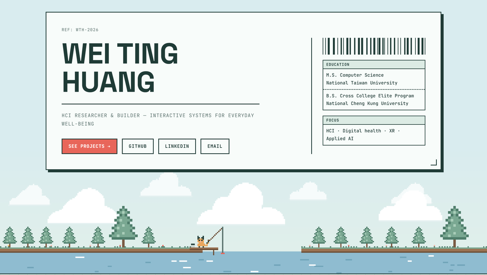

## Hi, I'm Wei Ting 🎏

HCI M.S. student (Computer Science) at **National Taiwan University**. I build interactive systems for digital health and behavior change — Android interventions, AIoT for older adults, XR games and LLM companions.

🌐 **Website: [weiting53.github.io](https://weiting53.github.io)** · [LinkedIn](https://www.linkedin.com/in/weiting53/)

### Projects

- **Winding Down** (thesis, ongoing) — Android system that gradually reduces phone stimulation before sleep, via screen overlays and on-device traffic shaping; evaluated in a field deployment.
- **[HueMates](https://github.com/weiting53/huemates-vr-game)** — cooperative mixed-reality game for Meta Quest (Unity, Netcode). [Demo video](https://youtu.be/T2s1jHeiLac)
- **[Virtual Boyfriend LLM](https://huggingface.co/wei535353/virtual-boyfriend-chinese-v2)** — Qwen2.5-7B fine-tuned with QLoRA on Traditional Chinese novel-character dialogues.
- **福氣貓 Lucky Cat** — AIoT elderly-care robotic cat with edge AI on Jetson Nano.
- **[My Bubble Tea Empire](https://github.com/weiting53/My-Bubble-tea-Empire)** — entrepreneurship narrative game, 2,000+ players on DOKIFIC.

### Tools

Python · Kotlin/Android · JavaScript · C++ · PyTorch (LoRA/QLoRA) · Unity / Meta Quest
